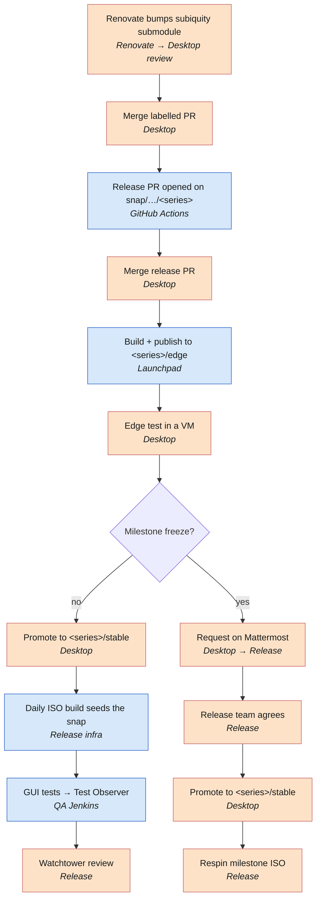

# The desktop team's role in the Ubuntu release process

This document explains how a change to the desktop installer (that includes changes in subiquity) gets from a commit to an Ubuntu ISO, who does each step, and how release milestones change the process.

It describes the process as it works today. Problems are collected in [Pain points](#pain-points) at the end.

Repositories involved:

- [canonical/ubuntu-desktop-provision](https://github.com/canonical/ubuntu-desktop-provision): the installer (`ubuntu-desktop-bootstrap`) and its snap.
- [canonical/subiquity](https://github.com/canonical/subiquity): the installer backend, included as a submodule.
- [canonical/ubuntu-gui-testing](https://github.com/canonical/ubuntu-gui-testing): the automated GUI tests.
- [~canonical-platform-qa/qa-jenkins-jobs](https://launchpad.net/qa-jenkins-jobs) on Launchpad: the Jenkins jobs that run those tests.

## Overview

Orange steps are manual and blue steps are automated. The second line of each node names the owner. The flowchart shows only the main path. Failures and rollback are covered in [When things go wrong](#when-things-go-wrong). A promotion during a milestone freeze also reaches the daily ISOs and the Jenkins tests, like any other promotion.

## From commit to ISO

### 1. Subiquity changes arrive through the submodule

Subiquity is pinned as a submodule at `packages/subiquity_client/subiquity`.

- **Who:** Renovate proposes the bump. A desktop team member (in practice mostly one person) reviews and merges it.
- **Automated or manual:** the PR is opened automatically. Review and merging are manual.
- **Trigger:** a new commit on the subiquity branch being tracked. Renovate has no schedule restriction.
- **Tool:** Renovate and GitHub. CI regenerates the subiquity API types, fails if the generated files are out of date, and runs integration tests.
- **On failure:** the reviewer fixes it on our side, for example by regenerating types or changing code. If subiquity itself broke something, it goes to the Subiquity team on Mattermost or at the weekly Monday sync.

Desktop maintainers choose which subiquity branch is tracked by hand. See [Subiquity branching at the end of the cycle](#subiquity-branching-at-the-end-of-the-cycle).

### 2. Merge the change and the release PR

- **Who:** a desktop team member.
- **Automated or manual:** merging a PR with a release label makes `snap-release.yaml` create or update a release PR on `snap/ubuntu-desktop-bootstrap/<series>` automatically. Someone has to merge that release PR by hand.
- **Trigger:** a labelled PR is merged.
- **Tool:** GitHub Actions.

### 3. Build and publish to edge

- **Who:** Launchpad.
- **Automated or manual:** automated.
- **Trigger:** the release PR is merged into the series branch. A launchpad import runs every couple of hours and can also be triggered manually if necessary.
- **Tool:** Launchpad builds the snap for amd64, arm64 and riscv64. It publishes each architecture to `<series>/edge` (for example `26.04/edge`) as soon as that architecture has built.
- **On failure:** see [Build failures](#build-failures).

### 4. Test on edge

No automated test covers edge snaps. This manual test is the only check before the installer reaches daily ISOs.

- **Who:** usually the person who merged the release PR, which in practice is mostly one desktop team member.
- **Automated or manual:** manual.
- **Trigger:** the tester's own initiative, after a fix or feature has landed. A new edge revision doesn't start testing by itself, and there's no notification or schedule.
- **Tool:** usually the tester boots the current daily ISO in a VM, runs `snap refresh ubuntu-desktop-bootstrap --channel=<series>/edge` in the live session, and relaunches the installer. For network-related fixes, where `snap refresh` doesn't work, they build a custom ISO with the `inject-snap` script in ubuntu-desktop-provision. That also lets them run parts of the ubuntu-gui-testing suite locally.
- **Scope:** ad hoc and focused on the change. It takes about 30 to 60 minutes. Results are shared informally in team chat.
- **On failure:** the snap stays on edge, and the bug is fixed in a new PR that goes through the same steps. Stable isn't touched.

### 5. Promote to stable

- **Who:** usually the same person who tested on edge. Anyone with Snap Store rights can do it.
- **Automated or manual:** manual, in the Snap Store web dashboard. The dashboard is preferred because it's less error-prone than the CLI.
- **Trigger:** the edge test passes, and all of amd64, arm64 and riscv64 have built. All architectures are promoted together, and riscv64 is usually the slowest.
- **Sign-off:** none outside freezes. The promoter's own edge test is the gate, sometimes with a heads-up in team chat. After Final Freeze, the release team must agree first (see [Milestones and releases](#milestones-and-releases)).
- **Channel:** only `<series>/stable`. Nothing is promoted to `latest/stable`.

### 6. Daily ISOs pick up the snap

- **Who:** the release team's image-build infrastructure.
- **Automated or manual:** automated.
- **Trigger:** each scheduled image build.
- **Tool:** the Ubuntu Desktop `live` seed lists the installer snap from `<series>/stable/ubuntu-<series>`, the **release branch**. Germinate and livecd-rootfs read the seed and install the newest revision on that channel into the live filesystem. The release branch is kept closed, so it falls back to `<series>/stable`, and each daily ISO includes whatever was last promoted.
- **On failure:** if the release branch doesn't exist, the build fails. See [Per-release Store branches](#per-release-store-branches).

### 7. Automated GUI tests

- **Who:** the release team maintains the Jenkins instance and jobs. The IS team provides the infrastructure, and the desktop team owns the tests in ubuntu-gui-testing.
- **Automated or manual:** automated.
- **Trigger:** Jenkins checks for newly published daily desktop ISOs every hour. Jobs exist for the latest LTS, `resolute`, on `amd64` and `amd64v3`. A snap channel update doesn't trigger tests, so tests only ever see the stable snap on an ISO.
- **Tool:** the job downloads the ISO, verifies it, and runs the Robot Framework suite in QEMU, using YARF and the old runner script from [hardware-installer-testing](https://github.com/canonical/hardware-installer-testing/). Coverage includes whole-disk install, LVM and ZFS encryption, TPM-backed full-disk encryption, and Secure Boot. Results go to Test Observer.
- **On failure:** see [Test failures](#test-failures). A failed run never blocks a promotion or a milestone image.

## Milestones and releases

- **Beta, RC and Final:** nothing is pinned. The desktop team stops promoting to `<series>/stable` during the milestone window. Because the release branch falls back to stable, the revision the ISO picks up stays the same.
- **Fixes during a milestone:** the desktop team asks the release team on Mattermost. Once they agree, the desktop team promotes by hand and the release team respins the ISO by hand. Respins are never automatic.
- **After Beta Freeze:** every promotion to stable needs the release team's agreement first. Other freezes are respected by planning, but the Snap Store doesn't enforce them.
- **Image builds:** the release team stops and restarts the image-build cron jobs around milestones and controls publication through the ISO tracker.
- **Manual testing:** the desktop team and community volunteers run the [ubuntu-manual-tests](https://github.com/ubuntu/ubuntu-manual-tests) on milestone ISOs. Whoever is available picks up installer test cases. If the release team sees no coverage in Test Observer, they ping the desktop team.
- **Image approval:** a desktop team member approves the image in Test Observer, usually after checking with their manager or the team's director. The release team waits for that approval. It's a separate step from the test results.

### Other release-team touchpoints

All of these are manual and informal:

- **Freeze exceptions:** requested on Mattermost. No FFe or UIFe bugs are filed for the installer snap.
- **Release-critical bugs:** the release team pings the desktop team on Mattermost. Whoever is around picks them up, and real blockers go through the milestone respin flow.
- **Seed changes:** rare. The desktop team proposes them, and the release team or an archive admin reviews them.
- **Release notes:** close to release (before Final, and before Beta if there's something worth noting), managers open PRs against [ubuntu/ubuntu-release-notes](https://github.com/ubuntu/ubuntu-release-notes/). The release team reviews and merges them.

### Point releases and SRUs

For point releases, the seed is changed to a point-release branch such as `26.04/stable/ubuntu-26.04.1`. Someone on the Subiquity team usually makes this change (they do the same for server), and sometimes the release team does. A desktop team member must create that Store branch by hand and can close it straight away so it falls back. If the branch doesn't exist, the ISO build breaks.

Stable release updates to the installer snap otherwise follow the same build, edge test and promote steps on the released series' branches.

## Once-per-cycle work

### Per-release Store branches

Every snap seeded on the ISO needs these each cycle. That covers the Apps subteam's snaps (`ubuntu-desktop-bootstrap`, `snap-store`, `firmware-updater`, `desktop-security-center`, `prompting-client`), the GNOME subteam's snaps (`gnome-*`, `gtk-common-themes`, `snapd-desktop-integration`), and snaps from outside the desktop team such as `mesa`.

1. **Track (in advance):** request a new `<series>` track on the Snap Store forum, for example [27.04 track for ubuntu-desktop-bootstrap](https://forum.snapcraft.io/t/27-04-track-for-ubuntu-desktop-bootstrap/53409).
2. **Release branch (start of cycle):** run `snapcraft release` to put a revision on `<series>/stable/ubuntu-<series>`, then `snapcraft close` on it straight away. The dashboard can't create branches. A closed branch falls back to `<series>/stable`, so the 30-day branch expiry doesn't matter.

Nobody is assigned and there's no checklist. If a branch is forgotten, the first ISO builds of the cycle fail and the release team reports it on Mattermost. Builds stop at the first missing branch, so it can take several rebuilds to find every missing one.

### Subiquity branching at the end of the cycle

1. Late in the cycle, the Subiquity team opens `ubuntu/<codename>` in canonical/subiquity.
2. The installer's `main` switches to tracking `ubuntu/<codename>`.
3. The desktop team cuts `ubuntu/<version>` (for example `ubuntu/26.10`), which keeps tracking `ubuntu/<codename>`.
4. The installer's `main` switches back to tracking subiquity's `main`.

Each switch is a manual PR in our repo. Backports to subiquity's `ubuntu/<codename>` are synced into `ubuntu/<version>` by hand. Coordination happens on Mattermost and at the weekly Monday sync.

### Base snap migrations

The ISO ships only one base, so every seeded snap has to move to a new base together. A new base comes out about every 4 cycles. The best time to move is the middle cycle between two LTS releases (27.04 for the next move).

- The desktop and Subiquity teams agree on the installer stack's move at the Monday sync. Nobody owns the move for the whole image.
- Each owner builds on the new base in edge and holds off promoting, or keeps a separate branch for the new base. All owners then promote at about the same time, coordinated on Mattermost.
- If a snap is promoted too early, the ISO build fails and the release team reports it. The usual fix is to re-release the previous revision.

## When things go wrong

### Build failures

- **Detection:** GitHub notifications reach the desktop team. One desktop team member follows Launchpad build-failure emails and checks builds by hand.
- **Response:** whoever notices retries the build first, then fixes forward with a PR. riscv64-only failures are looked at separately when they're a real riscv64 build problem.
- **Effect:** none on the release. Each architecture publishes on its own, and stable and the daily ISOs keep the previous revision.

### Test failures

- **Detection:** the release team reviews Jenkins and Test Observer in their daily **watchtower** standup and posts their findings in their public Mattermost channel. Nothing alerts anyone automatically.
- **Triage:** the release team makes a quick first assessment and pings the desktop team. One person usually investigates using the Jenkins console and artifacts, re-runs, and reproduces it locally if needed. The classification isn't recorded.
- **Response:** an installer bug is fixed forward (an issue is filed only if the fix isn't quick). A test bug gets a PR to ubuntu-gui-testing, and an infrastructure problem gets a ping on Mattermost.

## Pain points

### Cross-cutting

- **Single person, no formal owner:** edge testing, installer test triage, build failure handling and bad-promotion handling all depend on one desktop team member, and nobody formally owns them.
- **Informal, untracked communication with the release team:** freeze exceptions and release-critical bugs go through Mattermost, with no FFe bugs or tags. Bad promotions and rollbacks leave no record.
- **Store branches created by hand, with no checklist:** per-release branches across the Apps, GNOME and non-desktop snaps have no owner. A forgotten branch breaks ISO builds, and each failed build reveals only one missing branch.

### By stage

- **Subiquity:** nothing keeps `ubuntu/<version>` in sync with backports to subiquity's `ubuntu/<codename>`.
- **Edge testing:** no automated tests cover edge snaps, so manual testing is the only check before the installer reaches daily ISOs. It has no trigger, checklist or record.
- **Promotion:** the Snap Store enforces no freeze gate. All architectures are promoted together, so slow riscv64 builds delay amd64 and arm64.
- **Base snaps:** promoting an installer on a new base breaks ISO builds. There are no checks and no owner for the image-wide move, and moves happen so rarely that nobody remembers how the last one went.
- **Test triage:** nothing alerts anyone automatically. Only the watchtower posts do.
- **Milestones:** image approval has no clear owner and doesn't depend on the submitted test results. Mandatory test coverage is only tracked when the release team pings us.
